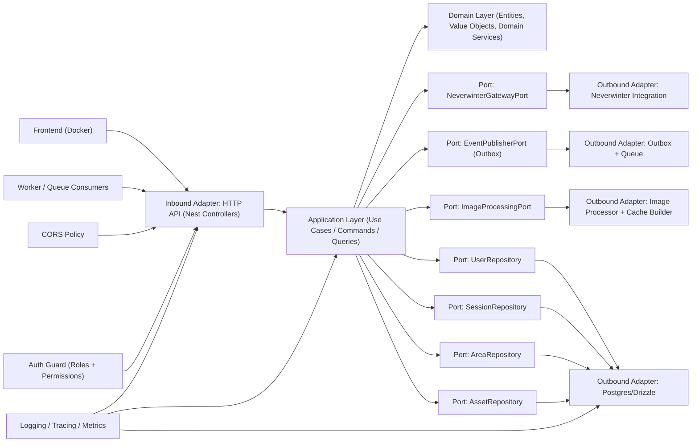
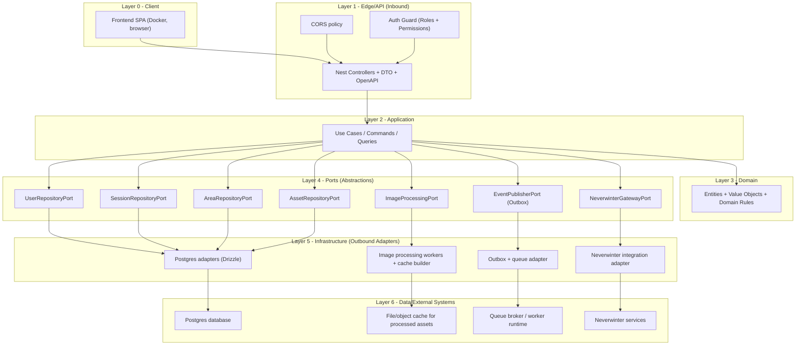

# Aurora Web Backend - Hexagonal Architecture

## Cel
Ten dokument opisuje docelowa architekture heksagonalna (Ports & Adapters) dla backendu Aurora Web.
Obecny kod dziala i ma zabezpieczenia CORS/RBAC, ale nie jest jeszcze w 100% rozdzielony heksagonalnie.

## Zasady
1. Domena nie zna NestJS, HTTP, SQL ani Docker.
2. Use case (application) zna tylko porty (interfejsy), nie zna adapterow.
3. Adaptery sa wymienialne (Postgres, cache, Neverwinter, image pipeline).
4. Inbound adapter (API) wywoluje use case; outbound adapter realizuje port.
5. Autoryzacja jest egzekwowana na backendzie (roles + permissions), nigdy tylko w UI.

## Diagram (Docelowy)


## Diagram warstwowy (Frontend -> Backend -> Data)


## Layer responsibilities (kto za co odpowiada)
1. Layer 0 - Client: frontend wysyla requesty i tylko renderuje UI.
2. Layer 1 - Edge/API: walidacja wejscia, auth, CORS, mapowanie HTTP -> use case.
3. Layer 2 - Application: scenariusze biznesowe, orkiestracja, transakcje aplikacyjne.
4. Layer 3 - Domain: reguly domenowe, encje i niezmienniki.
5. Layer 4 - Ports: kontrakty zaleznosci, brak szczegolow technologicznych.
6. Layer 5 - Infrastructure: implementacje portow (DB, image pipeline, outbox, integracje).
7. Layer 6 - Data/External: fizyczna baza, cache, kolejki, systemy zewnetrzne.

## Granice odpowiedzialnosci
1. Frontend nigdy nie omija backendowej autoryzacji.
2. Domain/Application nie importuja klas NestJS ani SQL drivera.
3. Adaptery outbound nie zawieraja logiki domenowej, tylko I/O i mapowanie.
4. Kazda nowa funkcja przechodzi sciezke: inbound -> use case -> domain -> port -> adapter.

## Warstwy
### 1) Domain (rdzen biznesowy)
- encje, value objecty, reguly biznesowe
- brak zaleznosci do frameworka
- przyklady: `User`, `Role`, `Permission`, `Area`, `Asset`

### 2) Application (use cases)
- orkiestruje scenariusz
- operuje na portach
- waliduje reguly aplikacyjne
- przyklady: `LoginUser`, `GetCurrentUser`, `ProcessAreaTextures`, `GetBenchmarkAreas`

### 3) Inbound adapters
- HTTP kontrolery, DTO, parsery request/response
- mapowanie request -> use case
- egzekwowanie auth (guard, role, permission)

### 4) Outbound adapters
- repozytoria DB (Postgres)
- integracje z systemami zewnetrznymi
- pipeline przetwarzania obrazow i cache
- outbox / queue

## Proponowany uklad katalogow backendu
```text
backend/src/
  modules/
    auth/
      domain/
      application/
      adapters/
        inbound/http/
        outbound/postgres/
    areas/
      domain/
      application/
      adapters/
        inbound/http/
        outbound/postgres/
        outbound/image-processing/
    assets/
      domain/
      application/
      adapters/
        inbound/http/
        outbound/postgres/
    benchmark/
      domain/
      application/
      adapters/
        inbound/http/
        outbound/postgres/
  shared/
    application/
    domain/
    infrastructure/
```

## Mapowanie obecnego stanu -> heksagon
1. `modules/auth/adapters/inbound/http/auth.controller.ts` -> inbound adapter (HTTP).
2. `modules/auth/application/auth.application.service.ts` -> use case/application service.
3. `modules/auth/application/ports/auth-repository.port.ts` -> port interfejsowy.
4. `modules/auth/adapters/outbound/**` -> adaptery infrastrukturalne (memory/postgres).
5. `modules/auth/adapters/inbound/http/access.guard.ts` -> inbound policy enforcement.
6. `common/http/cors.ts` -> inbound policy (granica sieciowa).

## Kolejnosc wdrozenia (bez rewolucji)
1. `DONE`: wydzielone porty i use case w module `auth`.
2. `DONE`: `auth` przepiety na porty + adaptery outbound.
3. Powtorzyc wzorzec dla `areas` i `assets`.
4. Dodac `ImageProcessingPort` + adapter worker/queue.
5. Dodac `EventPublisherPort` (Outbox) pod integracje Neverwinter.

## Definicja Done dla modulu heksagonalnego
1. Domena i use case bez zaleznosci do NestJS.
2. Kontroler nie zawiera logiki biznesowej.
3. Repozytoria i integracje tylko przez porty.
4. Testy: unit (domain/use case), regresja (API), mutacyjne (logika krytyczna).
5. Kontrola dostepu: role + permissions na akcjach.
