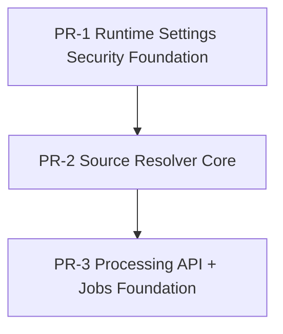

# PR Dependency Graph (R69): First 3 Implementation PRs

Data: 2026-05-24  
Zakres: PR-1, PR-2, PR-3 z planu `execution-plan-first-3-prs-r68.md`.

## 1. Kolejnosc merge (topologia zaleznosci)

Wymagana kolejnosc merge:
1. PR-1 -> `pr1-runtime-security`
2. PR-2 -> `pr2-source-resolver-core`
3. PR-3 -> `pr3-processing-jobs-api`

Regula wykonawcza: bez rownoleglego merge do tych samych plikow.

## 2. Konfliktowe pliki (matrix)

| Para PR | Konfliktowe pliki | Typ konfliktu | Ryzyko |
|---|---|---|---|
| PR-1 vs PR-2 | Brak plikow wspolnych (planowany brak overlapu) | N/A | Niskie |
| PR-1 vs PR-3 | `backend/src/modules/auth/domain/auth.policy.ts` (logicznie, niekoniecznie line-level) | Dryf polityki autoryzacji przy niezaleznym dopinaniu uprawnien | Srednie |
| PR-2 vs PR-3 | `backend/src/app.module.ts` | Klasyczny konflikt rebase/merge przy rejestracji modulow i providerow | Wysokie |

Pliki newralgiczne do ochrony przed konfliktem:
1. `backend/src/app.module.ts` (edycja tylko w PR-3).
2. `backend/src/modules/auth/domain/auth.policy.ts` (zmiany tylko w PR-1; PR-3 nie replikuje polityki auth).

## 3. Ryzyka rebase (per PR)

### PR-1 (Runtime Settings Security Foundation)
- Ryzyko R1: drift kontraktu runtime settings (types/schema/defaults/repository) jesli inne strumienie zmieniaja shape konfiguracji.
- Ryzyko R2: konflikt semantyczny w `auth.policy.ts` przy rownoleglych zmianach uprawnien administracyjnych.
- Ryzyko R3: rebase po zmianach bootstrap moze ukryc fail-fast dla `pathSecurity`.

### PR-2 (Source Resolver Core)
- Ryzyko R4: niskie line-level (nowy modul), ale mozliwy konflikt architektoniczny gdy ktos rownolegle podlacza ProcessingModule.
- Ryzyko R5: ryzyko semantyczne non-determinism po rebase, jesli tie-break/sorter zostanie czesciowo nadpisany.
- Ryzyko R6: drift policy dla `ARE/GIT` przy rownoleglych poprawkach rules engine.

### PR-3 (Processing API + Jobs Foundation)
- Ryzyko R7: wysoki konflikt rebase w `backend/src/app.module.ts` (importy/rejestracja modulow).
- Ryzyko R8: konflikt z `backend/src/database/schema.ts` przy rownoleglych migracjach/tabelach.
- Ryzyko R9: konflikt semantyczny idempotency/lifecycle przy rebase na zmienione porty/kontrakty processing.

## 4. Kryteria blokujace (merge blockers)

### Globalne (dla wszystkich 3 PR)
1. Nieprawidlowa kolejnosc: PR-2 bez merged PR-1, albo PR-3 bez merged PR-2.
2. Rownolegle edytowanie tych samych plikow przez inny strumien bez uzgodnionego ownership.
3. Niezgodnosc z gate P0: `npm run build`, `npm run test:unit`, `npm run test:e2e`.

### PR-1 blockers
1. Brak poprawnej walidacji/canonicalizacji path i fail-fast na bootstrap/PUT runtime settings.
2. Brak egzekucji permission split `admin.runtime_paths.write`.
3. Brak lub fail testow security/runtime settings.
4. Brak przejscia P1 dla security scope: `npm run test:mutation`.

### PR-2 blockers
1. Niedeterministyczny winner resolvera (tie-break niestabilny).
2. Naruszenie policy `ARE/GIT` module-bound lub brak poprawnych diagnostics (`SOURCE_*`).
3. Dodanie endpointow publicznych lub zmian DB w tym PR (poza zakresem).
4. Fail testow unit/integration/contract resolvera.

### PR-3 blockers
1. Niespojna maszyna stanow jobs (`status/phase`) albo konflikty atomowych przejsc.
2. Bledna idempotencja (duplikacje jobow, brak poprawnego conflict handling).
3. Problemy startup po podpieciu `ProcessingModule` albo regresja `app.module.ts`.
4. Brak przejscia P1 dla lifecycle/idempotency: `npm run test:mutation`.

## 5. Kolejnosc operacyjna rebase

1. Zamrozic merge PR-2 i PR-3 do czasu merge PR-1.
2. Po merge PR-1: rebase PR-2 na target branch i ponowne uruchomienie gate.
3. Po merge PR-2: rebase PR-3, rozwiazac konflikty tylko w `backend/src/app.module.ts` i `backend/src/database/schema.ts`, ponownie uruchomic gate.
4. Jesli pojawi sie konflikt semantyczny auth: priorytet ma logika z PR-1 (security foundation).
