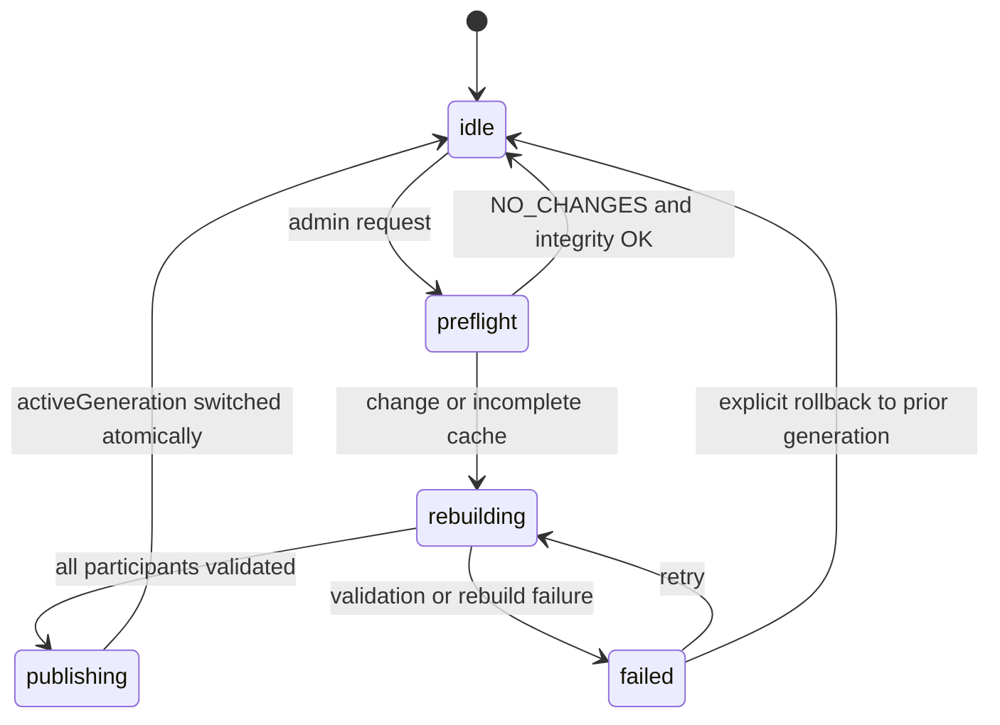
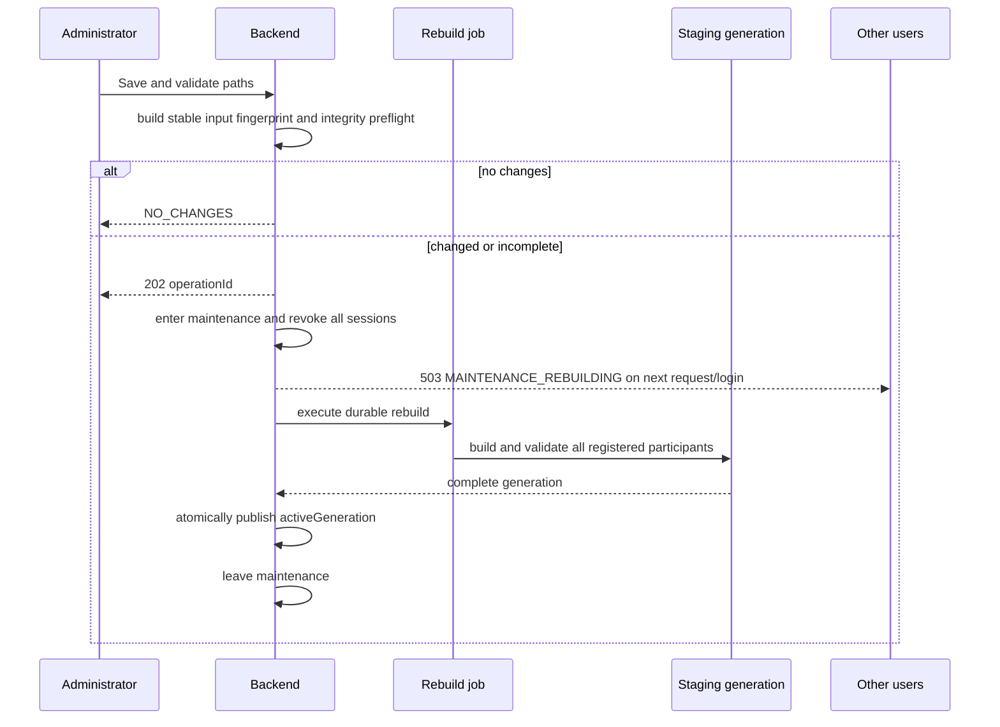
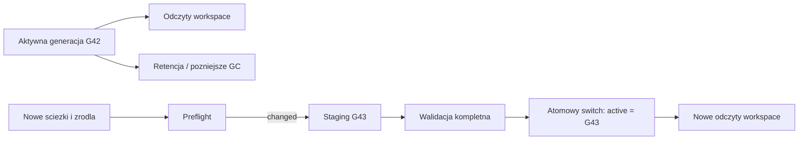

# Runtime cache cold rebuild i maintenance mode

## Status i decyzja

Status: **zaimplementowane 2026-07-17**.

Ten dokument opisuje wdrozony kontrakt globalnego odswiezenia danych Aurora Web po zmianie sciezek runtime lub na zadanie administratora.

Wdrozone rozwiazanie nie traktuje przycisku "Clear cache" jako prostego usuwania obiektow. Uzywa modelu **preflight -> nowa generacja -> atomowa publikacja**.

Obejmuje to cache backendu i jego pochodne dane. Backend nie moze bezposrednio usunac cache pamieciowego przegladarki; frontend ma dostac nowy identyfikator generacji i po zakonczeniu maintenance zaladowac aktualny stan.

## Granice

- Konfiguracja hosta Docker Compose pozostaje poza aplikacja: `.env` i ponowne `docker compose up --build` sa wymagane po zmianie bind mountow.
- Frontend przyjmuje rzeczywiste sciezki Windows/Linux hosta. W Dockerze
  backend tlumaczy je wedlug aktualnych zmiennych Compose na stabilne sciezki
  procesu, np. `/host/nwn-game`, i dopiero te sciezki waliduje.
- Istniejacy modul `runtime-settings` pozostaje wlascicielem konfiguracji sciezek i uruchomienia rebuilda.
- Zwykle `processing-jobs` sa zatrzymywane przez ten sam globalny gate przed enqueue i bezposrednio przed wykonaniem. Rebuild korzysta z trwalego rekordu `system_maintenance`; restart procesu zmienia przerwana operacje na `failed`, zachowujac retry/rollback zamiast otwierac workspace.
- Zwykle operacje cache pozostaja inkrementalne. Globalny cold rebuild dotyczy tylko sytuacji, w ktorych nowy fingerprint lub niespojnosc wymagaja zmiany aktywnej generacji.

## Niezmienniki

1. Uzytkownik nigdy nie odczytuje mieszanki starej i nowej generacji danych.
2. Identyczne wejscie i kompletne aktywne artefakty koncza operacje jako `NO_CHANGES`, bez maintenance i bez wylogowania.
3. Stary aktywny cache nie jest niszczony przed poprawnym zbudowaniem i zwalidowaniem nowego.
4. Przy bledzie system pozostaje w jawnym stanie maintenance albo administrator moze jawnie przywrocic poprzednia generacje. Nie wolno samoczynnie otwierac logowania do niezwalidowanego stanu.
5. Maintenance jest stanem trwalym i wspolnym dla wszystkich instancji backendu.
6. Kazdy cache zalezny od danych runtime jest przypisany do generacji albo jest zarejestrowanym uczestnikiem rebuilda.

## Model stanu

W stanie `rebuilding` i `publishing` logowanie oraz endpointy workspace sa
zablokowane. W stanie `failed` zwykli uzytkownicy nadal nie moga sie zalogowac,
ale backend dopuszcza logowanie administratora potrzebne do `retry` albo
`rollback`. Allowlista obejmuje health check, publiczny zredukowany status
maintenance oraz niezbedne endpointy auth/recovery.

Minimalny rekord trwaly maintenance zawiera:

- `operationId`, `state`, `startedAt`, `updatedAt`, `triggeredBy`;
- `leaseOwner` i monotoniczny `fencingToken` dla lidera operacji;
- `candidateRuntimeFingerprint`, `activeRuntimeFingerprint`;
- `stagingGeneration`, `activeGeneration`, poprzednia generacje;
- biezaca faze, bezpieczny komunikat bledu i podsumowanie uczestnikow.
- ograniczony do 200 wpisow audit trail przejsc: operator, czas, faza, fingerprinty, generacje i bezpieczny kod bledu.

Zrodlem prawdy jest trwaly rekord MySQL z compare-and-swap, `leaseOwner` i
monotonicznym `fencingToken`; wariant memory sluzy testom i uruchomieniom bez
bazy. Kazda instancja backendu odczytuje ten stan przed obsluzeniem logowania,
zadan chronionych i jobow.

## Konfiguracja aktywna i kandydacka

Zmiana sciezek, ktora moze zmienic dane zrodlowe, nie moze od razu stac sie aktywna dla workspace. `Save and validate` zapisuje poprawna konfiguracje jako kandydacka i uruchamia preflight.

- Gdy preflight zwroci `NO_CHANGES`, kandydat staje sie aktywny bez przerwy dla uzytkownikow.
- Gdy fingerprint sie zmieni albo integralnosc cache nie przejdzie, kandydat
  jest przechowywany w trwalym rekordzie maintenance, ktory przechodzi do
  `rebuilding`; workspace jest zamkniety do publikacji nowej generacji.
- Po sukcesie nowa konfiguracja i `activeGeneration` sa aktywowane jednym logicznym przejsciem.
- Po bledzie poprzednia aktywna konfiguracja i generacja pozostaja dostepne wyłącznie do jawnego rollbacku administratora.

To usuwa obecne okno niespojnosci: nowe sciezki zrodlowe i stare cache pochodne.

## Przeplyw administratora i uzytkownika

Po otrzymaniu `202` frontend administratora sam usuwa lokalna sesje. Pozostali klienci po nastepnym requestcie otrzymuja `503 MAINTENANCE_REBUILDING`, czyszcza lokalny stan autoryzacji i pokazuja ekran oczekiwania. Nie nalezy uzywac samego `401`, poniewaz nie odroznia ono maintenance od zwyklej wygaslej sesji.

## Preflight i fingerprint

Fingerprint opisuje **wejscie do danych**, a nie chwilowy stan procesu. Musi byc deterministyczny i zawierac:

- nazwy wzgledne, rozmiary i SHA-256 wszystkich wybranych plikow zrodlowych;
- rozwiazana, uporzadkowana liste katalogow HAK i ich priorytet;
- aktywne polityki zrodel (module, HAK, vanilla, referencja);
- istotne wartosci runtime settings, ale nie sam licznik `revision` ani dane telemetryczne;
- wersje parserow, generatorow, konwertera MDL->GLB i formatow cache;
- wersje kontraktow uczestnikow rebuilda.

`generatedAt`, identyfikator joba i inne metadane operacyjne nie moga wchodzic do hasha tresci. Obecny indeks tekstur zawiera czas generowania, dlatego jego hash nalezy rozdzielic na deterministyczna tresc oraz metadane. W przeciwnym razie identyczne dane zawsze wymuszałyby rebuild.

Rowniez rownosc fingerprintow nie wystarcza. Preflight sprawdza manifest aktywnej generacji: wymagane obiekty, ich checksumy, wersje formatow oraz zaleznosci. Brak jednego obiektu oznacza rebuild.

## Generacje zamiast destrukcyjnego czyszczenia

Zasoby blob storage sa zapisywane pod prefiksem generacji, a nie nadpisywane pod aktywnym prefiksem. Wskaznik aktywnej generacji jest publikowany przez atomowy zapis pliku runtime-settings; maintenance pozostaje zamkniety do zakonczenia tego przejscia. Dopiero osobna polityka retencji moze usunac stare, nieaktywne generacje.

Niezmienione obiekty sa rozpoznawane po SHA-256 i rozmiarze. W S3 sa kopiowane server-side z poprzedniej generacji, a w trybie host-local kopiowane w lokalnym mirrorze. Upload otrzymuja tylko obiekty nowe lub zmienione. Brak obiektu wykrywa porownanie faktycznej liczby obiektow z `fileCount` manifestu.

## Rejestr uczestnikow rebuilda

Cold rebuild ma jawny rejestr `RebuildParticipant`. Dodanie nowego cache do aplikacji wymaga jego wpisania do rejestru oraz testu kontraktowego. Minimum dla obecnego projektu:

| Uczestnik | Oczekiwane zachowanie |
| --- | --- |
| Snapshot modulu i manifest blob | Budowa do staging, porownanie hashy per plik, walidacja pelnej listy obiektow. |
| Zrodla vanilla/HAK/modeli/template | Rozwiazanie z kandydackich settings i wpis do manifestu generacji. |
| Indeks tekstur i lookup w pamieci | Deterministyczna tresc indeksu; lookup odnosi sie do `activeGeneration`. |
| Tiles, Sounds, Placeables, Areas | Klucze L1/L2 zawieraja generation/fingerprint; stary wpis nie jest widoczny po switchu. |
| Catalog i lazy auto-sync | Nie moze zapisywac do aktywnej generacji w maintenance; dziala tylko jako uczestnik staging. |
| Joby processing | Nie przyjmuja nowych zadan w maintenance i sprawdzaja blokade bezposrednio przed wykonaniem. |
| Frontend asset cache | Kontrakty URL/cache-key zawieraja generacje; klient po maintenance odswieza stan aplikacji. |

Nie trzeba globalnie kasowac L1/L2. Po zmianie `activeGeneration` stare wpisy staja sie nieosiagalne, a ich fizyczne sprzatanie jest osobnym zadaniem retencji.

## Uwierzytelnianie i API

Kontrakt auth zostal rozszerzony o `deleteAllSessions()`. Implementacja MySQL
wykonuje pojedyncze `DELETE FROM sessions`, a implementacja pamieciowa czysci
mape sesji.

Maintenance gate musi dzialac:

- przed `AuthApplicationService.authenticate()`, bo login jest endpointem publicznym;
- przed rozpatrzeniem zadan chronionych, aby aktywna karta nie otrzymala danych workspace;
- przy enqueue i tuz przed wykonaniem joba;
- z allowlista tylko dla health check i publicznego statusu maintenance.

Wdrożony kontrakt HTTP:

| Endpoint | Uprawnienie | Wynik |
| --- | --- | --- |
| `POST /settings/runtime/cache-rebuilds` | `admin.config.write` | `NO_CHANGES` albo `202` z `operationId`. |
| `GET /settings/runtime/cache-rebuilds/:id` | `admin.config.write` | Pelny postep, uczestnicy, liczniki i bezpieczne bledy. |
| `GET /system/maintenance` | publiczny | Tylko stan, faza i bezpieczny komunikat dla wylogowanego klienta. |
| `POST /settings/runtime/cache-rebuilds/:id/retry` | `admin.config.write` | Wznowienie nieudanej operacji. |
| `POST /settings/runtime/cache-rebuilds/:id/rollback` | `admin.config.write` | Jawne przywrocenie poprzedniej zwalidowanej generacji. |

Wszystkie sciezki sa wystawione pod prefiksem `/api/v1`. Starszy
`POST /settings/runtime/module-cache/rebuild` jest bezpiecznym aliasem tego samego
orchestratora i rowniez wymaga `confirmGlobalLogout=true`; nie wykonuje juz
destrukcyjnego syncu aktywnego prefiksu.

Uruchomienie ma miec idempotency key i wyrazne potwierdzenie w UI, poniewaz uniewaznia sesje wszystkich osob. Nalezy zapisac audit: kto uruchomil operacje, fingerprint przed/po, wersje, licznik obiektow, czas faz i blad bez danych wrazliwych.

## Odzyskiwanie po bledzie

- Restart backendu odtwarza rekord operacji i nie otwiera logowania automatycznie.
- Lease z fencing tokenem zapobiega rownoleglym liderom po restarcie lub pracy wielu instancji.
- Awaria staging nie zmienia `activeGeneration`.
- Retry korzysta z tego samego snapshotu wejscia albo jawnie tworzy nowy preflight, jezeli zrodla zmienily sie w trakcie operacji.
- Wykrycie zmiany zrodel pomiedzy preflight i publikacja powoduje odrzucenie staging i ponowny preflight; nie wolno publikowac wyniku TOCTOU.

## Vertical slices wdrozenia

1. **Foundation maintenance i auth** — trwaly rekord, lease, gate, `revokeAllSessions`, publiczny status i ekran oczekiwania. Gotowe, gdy login i wszystkie chronione requesty sa blokowane deterministycznie.
2. **Deterministyczny preflight** — manifest wejsc, separacja metadanych czasu, weryfikacja integralnosci, wynik `NO_CHANGES`. Gotowe, gdy dwa identyczne uruchomienia nie robia zadnego zapisu.
3. **Staging i atomowa publikacja** — prefiksy generacji, pointer aktywnej generacji, walidacja, rollback i retencja. Gotowe, gdy awaria w polowie nie zmienia odczytow workspace.
4. **Uczestnicy danych** — snapshot, zrodla, tekstury, Tiles, Sounds, Placeables, Areas, Catalog i joby sa przypiete do generacji. Gotowe, gdy zaden stary wpis nie jest odczytywany po switchu.
5. **Panel i operacje** — potwierdzenie, postep, szczegoly admina, stan dla wylogowanego uzytkownika, retry/rollback i audit log. Gotowe, gdy administrator moze obsluzyc sukces oraz blad bez dostepu do kontenera.

## Mapa wdrozenia

| Warstwa | Implementacja |
| --- | --- |
| Trwaly stan i CAS | `system-maintenance` z repozytorium MySQL/memory, monotonicznym `fencingToken`, `leaseOwner` i audit trail. |
| Globalny gate | `AccessGuard`, login w `AuthApplicationService` oraz ponowna kontrola przed wykonaniem processing joba. |
| Sesje | `AuthRepositoryPort.deleteAllSessions()` dla MySQL i memory. |
| Preflight | deterministyczny fingerprint plikow, polityk zrodel i wersji konwerterow oraz walidacja manifestu aktywnej generacji. |
| Staging/publish | `RuntimeCacheRebuildApplicationService`, prefiks `__generations/<id>`, walidacja, kontrola TOCTOU i atomowy zapis runtime-settings. |
| Cache | generacyjny namespace L1 oraz prefiks L2 dla Placeables, Tiles, Sounds i Areas; invalidacja katalogow snapshotu po publikacji. |
| Frontend | onboarding sciezek, przycisk `Rebuild runtime cache`, publiczny ekran maintenance, polling, wylogowanie lokalne oraz admin retry/rollback. |
| Docker | hostowe zmienne w `.env`, stabilne mounty `/host/...`; aplikacja ich nie edytuje i nie restartuje Compose. |

## Weryfikacja implementacji

Automatyczne testy obejmuja:

- jeden lease dla rownoleglych requestow z tym samym idempotency key;
- wzrost fencing tokenu przy kazdym przejsciu i zachowanie audit trail;
- `NO_CHANGES` bez uniewaznienia sesji i bez staging;
- sukces staging -> integrity -> publish;
- kopiowanie niezmienionych obiektow pomiedzy generacjami;
- wymuszenie rebuilda przy niezgodnym `manifestFileCount`;
- blokade loginu/workspace, globalne uniewaznienie sesji i admin-only recovery;
- komunikat Docker mount oraz potwierdzenia operacji w UI.

## Kryteria akceptacji

- Identyczne zrodla: `NO_CHANGES`, zero wylogowan i zero upload/delete.
- Zmiana jednego pliku HAK: tylko zalezne elementy staging sa przebudowane, potem jeden atomowy switch.
- Brak obiektu przy takim samym fingerprint: rebuild jest wymuszony.
- Zmiana sciezek: workspace pozostaje zamkniety do aktywacji generacji zgodnej z nowym fingerprintem.
- Login podczas maintenance: `503 MAINTENANCE_REBUILDING` i brak tworzenia sesji.
- Aktywne sesje: sa uniewaznione globalnie, wlacznie z sesja administratora uruchamiajacego operacje.
- Blad uczestnika: stara generacja nie jest nadpisana, stan i retry sa widoczne administratorowi.
- Restart w trakcie: maintenance pozostaje aktywny, a operacja jest odzyskiwalna.
- Dwa rownolegle klikniecia lub dwie instancje backendu: istnieje jeden lider i jedna operacja logiczna.
- Klient po ponownym otwarciu pobiera zasoby nowej generacji, bez starych URL-i i wpisow pamieciowych.

## Czego ten kontrakt nie robi

- Nie zmienia bind mountow Docker Compose ani `.env` z poziomu aplikacji.
- Nie restartuje kontenerow.
- Nie traktuje numeru rewizji settings jako dowodu zmiany danych.
- Nie usuwa obecnego, zwalidowanego cache przed gotowoscia nastepnego.
