# Area Create CRUD implementation plan

Date: 2026-08-06  
Status: proposed implementation plan; no product implementation authorized by this document  
Scope owner: Areas  
CRUD slice: **Create only**

Parent program:
`docs/brainstorm/2026-08-06-area-authoring-crud-tile-parity-program.md`.
This document remains the detailed Create workstream. It is not the completion
plan for the whole Area authoring product, full CRUD, exhaustive tile rendering,
or native connectivity.

## 1. Objective

Complete the Create slice of Area CRUD so an authorized user can author a new
Area locally, validate it against a versioned Aurora creation profile, and add
an ARE/GIT/GIC resource triplet plus the corresponding `module.ifo` Area entry
to one explicitly identified editable module without partial state, silent
normalization, or an unsupported Aurora-parity claim.

Completion means more than making `POST /areas/editing/persist/new-area`
return HTTP 201. The exact bytes emitted by the application must pass an
independent structural validator, survive native Toolset open/Save/Build and
packed readback, and load in NWN through the accepted AUR-S07 route. Every
persistable tileset/size/profile combination exposed by the UI must be covered
by the declared release evidence.

This plan is based on:

- `docs/audits/area-creation-application-audit-2026-08-06.md`;
- `backend/docs/aurora-reverse/area-creation-decompilation-audit-2026-08-06.md`;
- AUR-S05-05 native New Area evidence;
- AUR-S05-06 verified negative Area-resize evidence;
- the current Area editor, GFF writers, module snapshot transaction, and tests;
- the canonical rules-first, Aurora-first, contract-first, TDD, and
  diagnosability-first policies.

## 2. Scope decision

### 2.1 In scope

1. A new Area with:
   - explicit `name`, `resRef`, and `tag`;
   - one evidence-backed creation profile;
   - one SET/tileset supported by that profile;
   - final width and height selected before materialization;
   - a complete row-major `Tile_List`;
   - tile ID, orientation, height, four light bytes, and three animation-loop
     bytes per cell;
   - an initially empty but canonically structured GIT object set;
   - a canonically structured GIC;
   - a preserved and updated `module.ifo` `Mod_Area_list`;
   - deterministic output and complete provenance.
2. Local authoring of terrain, crosser, complete SET groups, tile replacement,
   tile orientation, height, and erase operations already supported by the
   editor, subject to the selected creation profile.
3. Strict server-side validation, authorization, idempotency, concurrency
   protection, collision handling, transaction recovery, readback, audit
   events, and actionable diagnostics.
4. A frontend state machine that keeps ordinary Save local and presents module
   materialization as a separate privileged action.
5. Golden, round-trip, integration, failure-injection, regression, mutation,
   determinism, performance, browser, Toolset, and NWN gates.
6. A profile allowlist so unsupported combinations remain local/experimental
   and cannot be persisted.

### 2.2 Explicitly out of scope

1. Read, Update, and Delete Area CRUD implementation, except for interfaces
   deliberately reusable by those later slices.
2. Creation of non-empty GIT object lists. Creature, door, placeable, item,
   encounter, sound, store, trigger, and waypoint CRUD remain separate work.
3. Exact emulation of Toolset's automatic name/ResRef/tag generator. The web
   contract takes these as separate explicit values and makes no wizard-parity
   claim.
4. Exact reproduction of Toolset's random blank-tile selection algorithm. The
   web editor uses an explicit, versioned, deterministic project policy whose
   output must be natively accepted.
5. Native Area expansion-resize parity. Creation always serializes the final
   complete dimensions; sparse native resize is forbidden.
6. A general native PathConnect or traversability claim. Structural Area
   creation can complete without it. Any UI or documentation that claims
   connected/traversable terrain remains blocked until separate native
   PathConnect evidence exists.
7. Full 99-tileset availability at the first production milestone. Only
   evidence-backed profiles may be enabled for persistence.
8. A project-local Toolset/NWN runner. All live evidence must use the central
   Aurora operator routes.

### 2.3 Extension seam for the remaining CRUD slices

The Create command, transaction port, module revision guard, resource
validator, and audit envelope must be designed so Update and Delete can later
reuse them. No speculative Update/Delete endpoints or behavior should be
implemented in this slice.

### 2.4 Completion levels

1. **Create implementation complete** means the entire Definition of Done in
   section 19 passes for at least one immutable creation profile and the
   production UI exposes only that certified allowlist for persistence.
2. **Create generally available** means the same Definition of Done covers
   every profile/tileset/dimension combination offered as persistable. Local
   experimental combinations do not count as generally available.
3. **Aurora Wizard parity** is a separate claim and remains out of scope. A
   project-defined deterministic initializer can be production-complete when
   its exact output is strictly valid and natively accepted without claiming
   the Toolset's random/default-selection algorithm.
4. **Connected/traversable Area parity** is also separate. It requires native
   PathConnect evidence in addition to structural Create completion.

## 3. Current baseline

### 3.1 Existing positive capabilities

- The frontend can create a blank local Area and edit a complete tile grid.
- The backend parses SET definitions and validates tile/group topology.
- Source-backed ARE edits preserve supported original root and tile fields.
- New-Area persistence checks collisions, updates `Mod_Area_list`, verifies
  stored bytes, and attempts rollback.
- Focused Area tests currently pass: 29 backend and 74 frontend tests.
- Local proof exists for group placement, tile replace, tile transform,
  eraser, and undo/redo.
- AUR-S05-05 provides one verified native `MicroSet`/`Tiny` 2x2 reference.

### 3.2 Release-blocking defects

- A new ARE emits six root fields instead of the strict 43-field profile.
- New tile animation loops default to 0 instead of the verified profile's 1.
- The empty GIT uses `ItemList` instead of top-level `List` and omits native
  sound/music defaults.
- The empty GIC has zero fields instead of the native sample's nine.
- The persistence verifier proves topology and storage equality, not native
  resource validity.
- The frontend component imports HTTP adapters directly instead of using an
  application facade and port.
- The mutation endpoint has a read-oriented permission surface rather than an
  explicit Area-create capability.
- The canonical FE-BE contract does not define Area creation.
- No application-generated candidate has passed Toolset or NWN.
- The broad automated baseline is red and the current checkout is not a clean,
  reviewable release candidate.

## 4. Required product decisions

These decisions must be recorded before implementation code starts.

### D-01 - two distinct save concepts

`Save draft` remains local and non-production. `Create Area in module` is a
separate, explicit, role- and permission-gated command with a confirmation
summary. A local Save must never silently invoke the module mutation.

### D-02 - explicit identity policy

The user supplies `name`, `resRef`, and `tag` separately. The server validates
each field and serializes it exactly according to its GFF type. It does not
derive `tag = resRef` unless a separately named project-policy option is
selected and recorded in the command.

### D-03 - immutable creation profiles

Every persisted Area names an immutable `creationProfileId` and profile
fingerprint. A profile contains exact typed defaults, evidence references,
supported tilesets/dimensions, validator version, and capability claims.
Changing any default creates a new profile version and fingerprint.

### D-04 - deterministic project initialization is not wizard parity

Blank-grid initialization has a named algorithm version and explicit seed.
The same normalized input, profile, source fingerprints, and code revision
must produce byte-identical ARE/GIT/GIC. Native acceptance is required, but
the product does not claim to reproduce the Toolset's random sequence.

### D-05 - final dimensions only

An Area is materialized at its final dimensions with exactly
`width * height` non-null cells. Web resize may remain a local project
operation, but no native resize semantic is claimed and no sparse source or
candidate is accepted.

### D-06 - profile allowlist controls the release surface

The persist action is enabled only when the exact tileset, dimensions,
creation profile, and required renderer readiness are certified. Unsupported
combinations can remain editable locally but are visibly labelled
experimental and cannot reach the mutation endpoint.

### D-07 - strict validation and native proof are independent

The serializer cannot validate itself. A separate parser/policy validator
must inspect emitted bytes. Native Toolset and NWN proof then validate the
external consumers. Neither layer substitutes for the other.

### D-08 - no partial module visibility

The module must expose either the exact pre-command state or the complete new
Area state. A reference to missing resources, an unreferenced committed
triplet, or an unverified compensation result is never a successful outcome.

## 5. Target architecture

```mermaid
flowchart LR
    UI["Area Create UI"] --> F["AreaCreationFacade"]
    F --> P["AreaCreationPort"]
    P --> V["Versioned HTTP API"]
    V --> A["AreaCreationApplicationService"]
    A --> R["CreationProfileRepository"]
    A --> C["Deterministic Candidate Compiler"]
    C --> X["ARE / GIT / GIC bytes"]
    X --> I["Independent Strict Validator"]
    I --> T["ModuleAreaTransactionPort"]
    T --> B["Snapshot / packed module storage"]
    B --> Q["Independent persisted readback"]
    Q --> E["Audit and provenance envelope"]
    E -. release proof .-> TS["Toolset native geometry and Build"]
    TS -. runtime proof .-> NWN["AUR-S07 NWN load"]
```



### 5.1 Backend boundaries

Recommended bounded responsibilities:

1. `AreaCreationProfileRepository`
   - returns immutable, fingerprinted creation profiles;
   - never derives defaults from the request;
   - rejects an unknown or superseded fingerprint.
2. `AreaCandidateCompiler`
   - pure deterministic transformation from validated command + profile to
     ARE/GIT/GIC and IFO patch intent;
   - contains no storage, HTTP, role, or telemetry logic.
3. `AreaCandidateValidator`
   - reparses emitted resources through an independent raw-GFF path;
   - applies the approved strict creation policy;
   - returns coded diagnostics and hashes.
4. `ModuleAreaTransactionPort`
   - owns module lock, revision check, staging, commit, readback, compensation,
     journal, and recovery;
   - exposes no GFF domain decisions.
5. `AreaCreationApplicationService`
   - orchestrates authorization context, profile, validation receipt,
     compilation, independent validation, transaction, and response;
   - does not contain binary GFF encoding details.
6. HTTP controller/schema adapters
   - reject unknown fields and invalid versions at the boundary;
   - require mutation-specific role, permission, idempotency, and precondition
     headers.

The existing `AreaEditingApplicationService` should be reduced to query/export
editing responsibilities or delegate creation to the new service. It must not
remain a growing mixed query/compiler/transaction utility.

### 5.2 Frontend boundaries

1. `AreaCreationFacade` owns the create state machine and command lifecycle.
2. `AreaCreationPort` defines profile query, validation, and create methods.
3. `HttpAreaCreationAdapter` implements the port.
4. Composition code injects the adapter into the facade.
5. `AuroraAreaEditingPanel` receives facade state/actions and does not import
   HTTP adapters.
6. The existing domain editor remains deterministic and framework-independent.

### 5.3 Complexity budget

- one frontend facade and one narrow Area-creation port;
- one backend orchestration service;
- one profile repository port;
- one compiler port/adapter;
- one independent validator;
- one transaction port/adapter;
- no new Toolset/NWN runner;
- no server-side rendering;
- no Update/Delete implementation;
- no duplicate GFF codec;
- no binary defaults embedded in React or controller code;
- no controller or UI component containing transaction/domain rules.

Exceeding this boundary requires an architecture decision record explaining
why a smaller composition is insufficient.

## 6. Creation profile contract

### 6.1 Proposed profile identity

Schema: `aurora-area-creation-profile/v1`.

Required fields:

- `profileId` and semantic version;
- immutable profile SHA-256;
- admitted Toolset/NWN binary hashes;
- source evidence packet paths and hashes;
- supported SET ResRefs and SET fingerprints;
- supported dimension policy;
- identity field policy and GFF types;
- deterministic grid initializer ID and allowed seed policy;
- ordered ARE root field definitions with exact GFF types and values;
- ordered per-tile field definitions and defaults;
- ordered GIT root/list/AreaProperties definitions and defaults;
- ordered GIC root field definitions and defaults;
- IFO Area-entry type and preservation policy;
- expected resource types and filenames;
- strict validator policy/version;
- capability labels such as `structuralCreate`, `toolsetOpen`,
  `toolsetBuild`, `nwnLoad`, and `pathConnect`;
- explicit `unknowns` and `mustNotClaim` lists.

### 6.2 First profile

The first candidate should be derived from the existing AUR-S05-05
`MicroSet`/`Tiny` packet and named as a profile-specific baseline, not a global
Aurora default. Before it is used by product code, research must recover and
record:

1. all ARE root labels, types, and values in the native sample;
2. all GIT root/AreaProperties labels, types, and values;
3. all nine GIC labels, types, and values;
4. exact IFO child structure type, ResRef field, list ordering, and unaffected
   root fields;
5. the dependency of defaults on tileset, Area size, module state, locale, and
   Toolset build;
6. whether field order is consumer-significant or only a determinism policy;
7. exact source hashes and evidence lineage.

No code should fill an unknown value with zero merely because zero parses.

### 6.3 Additional certification samples

Before the UI enables a general create surface, capture at minimum:

- the existing 2x2 MicroSet/Tiny sample;
- one additional final dimension created directly through the wizard;
- one interior and one exterior tileset selected from the verified native
  list after discovery;
- one deterministic edited topology using only cells supported by its profile.

The sample set must be expanded when evidence shows a default depends on
tileset, size, locale, module version, or Toolset branch. Do not assume three
samples prove all 99 tilesets.

## 7. FE-BE contract-first proposal

The canonical FE-BE contract v1 must be extended before code implementation.
The final names are a contract decision, but the recommended additive surface
is:

1. `GET /api/v1/area-creation/profiles`
   - returns only profiles available to the current module/workspace and user;
   - includes profile fingerprint, certified tilesets/dimensions, capability
     labels, and unsupported-claim warnings.
2. `POST /api/v1/modules/{moduleId}/area-creation-validations`
   - performs complete server-side validation and compilation without writes;
   - returns a short-lived verification receipt bound to the normalized
     command hash, module revision, profile fingerprint, SET fingerprint,
     validator version, resource hashes, and diagnostics.
3. `POST /api/v1/modules/{moduleId}/areas`
   - creates exactly one new Area;
   - requires the same normalized command plus verification receipt;
   - recomputes all gates server-side and never trusts the receipt as a bypass;
   - returns 201 only after committed independent readback.

The current `/areas/editing/verify`, `/areas/editing/export/area.are`, and
`/areas/editing/persist/new-area` routes should become compatibility adapters
or be explicitly deprecated. They must not remain an undocumented parallel
contract.

### 7.1 Request schema

Schema name: `area-create-command.v1`.

Required data:

- target `moduleId` and expected module revision/fingerprint;
- `creationProfileId` and profile fingerprint;
- explicit `name`, `resRef`, and `tag`;
- tileset ResRef and SET fingerprint;
- width, height, initializer algorithm version, and seed;
- complete row-major tile list;
- per-tile ID, orientation, height, four light bytes, and three animation-loop
  bytes;
- declared complete group instances used only for validation/reconstruction;
- local draft revision and normalized draft SHA-256;
- client command ID for diagnostics, never as authorization.

All top-level fields are strict. Unknown fields are rejected. Binary resources
are never accepted from the browser.

### 7.2 Required headers

- `Authorization`;
- `Content-Type: application/json; charset=utf-8`;
- `X-Contract-Version: 1.x` where strict client mode is enabled;
- `Idempotency-Key` for create;
- `If-Match` with the expected module revision/ETag for create.

### 7.3 Success response

The 201 response must include:

- `areaId`, `resRef`, `name`, and `tag`;
- exact module ID and new revision/ETag;
- transaction ID and idempotency result (`created` or replayed original);
- profile ID/fingerprint and validator version;
- ARE/GIT/GIC and resulting IFO size and SHA-256;
- persisted object keys/resource identities;
- normalized draft hash and SET fingerprint;
- coded warnings, with no errors;
- readback status and creation timestamp;
- capability claims actually certified for this Area.

### 7.4 Error contract

At minimum define:

- `AREA_CREATE_PROFILE_UNSUPPORTED` (422);
- `AREA_CREATE_PROFILE_STALE` (409);
- `AREA_CREATE_TILESET_STALE` (409);
- `AREA_CREATE_DRAFT_INVALID` (422);
- `AREA_CREATE_CANDIDATE_INVALID` (422);
- `AREA_CREATE_VERIFICATION_STALE` (409);
- `AREA_CREATE_RESOURCE_COLLISION` (409);
- `AREA_CREATE_MODULE_REVISION_CONFLICT` (412);
- `AREA_CREATE_IDEMPOTENCY_CONFLICT` (409);
- `AREA_CREATE_PERMISSION_DENIED` (403);
- `AREA_CREATE_STORAGE_UNAVAILABLE` (503 or capability-specific 501);
- `AREA_CREATE_TRANSACTION_FAILED` (500/503 with non-sensitive recovery state);
- `AREA_CREATE_ROLLBACK_FAILED` (500 plus module quarantine identifier);
- `AREA_CREATE_READBACK_FAILED` (500);
- `AREA_CREATE_PAYLOAD_TOO_LARGE` (413).

Every error returns a stable code, safe message, `retryable`, field diagnostics
where applicable, request ID, and transaction/recovery correlation where safe.

### 7.5 Authorization contract

- Define an explicit `area.create` permission.
- Permit only declared builder/DM/admin roles that also have `area.create`.
- Deny viewer and every unmapped role.
- Do not rely on `scene.read`, class-level broad permissions, or UI visibility.
- Record actor ID, role set, target module ID, command hash, and result in the
  audit event, while keeping high-cardinality values out of metric labels.

### 7.6 Payload and performance contract

Before contract freeze, benchmark the current maximum supported 32x32 grid and
record a final payload limit. Initial engineering targets are:

- Area-create JSON at or below 2 MiB and never above the existing 25 MiB draft
  ceiling;
- validation + deterministic compilation + independent parse at or below
  1 second p95 on the declared CI/reference host for 32x32;
- complete local snapshot transaction at or below 5 seconds p95, excluding an
  unavailable external object store;
- frontend blank-grid initialization without a main-thread task above 100 ms;
- additional backend heap below 64 MiB for one maximum-size command;
- one module-scoped create transaction at a time.

These are project SLO decisions, not Aurora semantics. If measurement shows a
target is inappropriate, update the contract and benchmark record before
implementation rather than silently widening the budget in code.

## 8. Transaction design

### 8.1 State machine

`received -> authorized -> locked -> source_read -> compiled -> validated -> staged -> committed -> readback_verified -> completed`

Failure states:

`rejected | compensation_pending | compensated | quarantine_required`

Every transition is journalled with request, module, profile, draft, resource,
and code revision hashes. The journal must be recoverable after process death.

### 8.2 Ordered algorithm

1. Normalize request and compute command hash.
2. Resolve the idempotency key before any mutation.
3. Authorize `area.create` on the exact module.
4. Acquire one module-scoped lease/lock.
5. Re-read module revision and reject stale `If-Match`.
6. Read and hash the current IFO and resource index.
7. Reject ARE/GIT/GIC or `Mod_Area_list` collisions.
8. Resolve and fingerprint the immutable creation profile and SET source.
9. Compile candidate resources deterministically in memory.
10. Reparse and independently validate ARE/GIT/GIC plus the proposed IFO.
11. Stage resource bytes and verify staged hashes.
12. Commit resources and IFO through an atomic batch when supported.
13. When atomic batch is unavailable, use a durable write-ahead journal and a
    storage-specific staged commit that never exposes an IFO reference before
    its resources are durable.
14. Re-read every committed object and validate byte hashes, GFF structure,
    `Mod_Area_list`, and module revision.
15. Store the immutable idempotent response.
16. Emit completion and release the lock.

### 8.3 Failure and recovery rules

- No automatic blind retry after an unknown write outcome.
- A same-key retry first reconciles the journal and persisted hashes.
- Compensation is exact and verified; delete only resources owned by the
  transaction and restore only the exact before-IFO bytes.
- A failed compensation quarantines the module from further writes and emits
  `AREA_CREATE_ROLLBACK_FAILED`.
- Recovery never assumes missing means absent; it performs readback.
- Concurrent unrelated module changes fail the revision gate rather than being
  overwritten.
- IFO is never patched from a stale in-memory copy.
- Existing `Mod_Entry_Area` is preserved and independently validated; Create
  does not silently change the module entry Area.

### 8.4 Crash-injection points

Tests must terminate/restart the transaction after each boundary:

- after lock;
- after source read;
- after candidate compilation;
- after validation;
- after staging each resource;
- before and after IFO commit;
- after each final resource commit where batch atomicity is unavailable;
- during readback;
- during compensation;
- after completion before idempotency response persistence.

Every case must converge to exactly baseline or complete state.

## 9. Serializer and validator work

### 9.1 ARE compiler

1. Emit the complete profile-defined root field set with exact GFF types.
2. Serialize `Name`, `ResRef`, and `Tag` independently.
3. Enforce width/height bounds from the selected profile.
4. Require exactly `width * height` row-major tile structs.
5. Emit all ten current per-cell fields:
   - `Tile_ID`;
   - `Tile_Orientation`;
   - `Tile_Height`;
   - four light bytes;
   - three animation-loop bytes.
6. Use profile defaults only when a field is explicitly unset and the profile
   authorizes a default.
7. Never fabricate `Tile_ResRef` or serialized group membership.
8. Preserve a stable canonical field order for deterministic byte output,
   while documenting whether that order is product policy or native evidence.

### 9.2 GIT compiler

1. Emit canonical empty lists including top-level ground-item `List`.
2. Emit a profile-defined `AreaProperties` struct and every native default
   field required by the certified profile.
3. Preserve exact numeric types and values for ambient/music/environment data.
4. Emit no object instances in this Create slice.
5. Never reuse inventory `ItemList` vocabulary for the Area ground-item list.

### 9.3 GIC compiler

1. Decode and document all native profile fields before implementation.
2. Emit exact labels, types, struct type, and profile values.
3. Treat every unresolved field as an Aurora research blocker, not zero.

### 9.4 IFO patcher

1. Preserve all supported existing root fields and child structures.
2. Append exactly one Area child with the confirmed type and ResRef.
3. Preserve existing list order and `Mod_Entry_Area`.
4. Reject duplicates case-insensitively under the explicit ResRef policy.
5. Reparse and verify the complete proposed IFO before commit.
6. Prove the same behavior against the real Last City IFO fixture and a small
   synthetic corpus containing nested lists/structs and every supported type.

### 9.5 Independent strict validator

The validator must not import the compiler's field list or expected output
builder. It may share low-level GFF reading primitives, but policy data comes
from the immutable profile and approved validation contract.

It verifies:

- file type/version and root struct type;
- required ARE/GIT/GIC fields and exact types;
- duplicate labels and alias policy;
- tile cardinality and list spans;
- tile value domains and profile constraints;
- exact empty-object list cardinality;
- AreaProperties and GIC profile values;
- IFO reference closure and resource-type mapping;
- resource filenames/ResRefs and cross-resource identity;
- deterministic hashes;
- no unexpected synthetic degradation in strict mode.

The strict Area/parser MH-01, MH-02, MH-03, MH-05, MH-07, and MH-08 HOLD items
must be closed by primary evidence before the general strict parser is called
complete. If a narrowly profile-specific validator proceeds earlier, its
limits must be explicit and it cannot enable general production persistence.

## 10. Frontend workflow

### 10.1 State machine

`idle -> profile_loading -> local_draft -> dirty -> verifying -> verified -> creating -> created`

Alternative states:

`unsupported | stale | validation_failed | create_failed | recovery_required`

Any change to name, ResRef, tag, SET fingerprint, profile, dimensions, seed,
or tiles invalidates the verification receipt immediately.

### 10.2 User flow

1. Choose `New local Area`.
2. Load supported creation profiles and explain certification status.
3. Enter distinct Name, ResRef, and Tag.
4. Choose only a profile-supported SET and final dimensions for persistable
   mode; allow unsupported local experiments only under an explicit label.
5. Create the deterministic local grid and show initializer version/seed.
6. Edit the Area locally with existing tools.
7. Save draft locally without module mutation.
8. Run `Validate for module creation` and display structured diagnostics.
9. On success show a confirmation summary: target module/revision, identity,
   profile, dimensions, tile count, resource hashes, warnings, and capability
   claims.
10. Execute `Create Area in module` once; prevent duplicate submissions while
    preserving the same idempotency key for a safe retry.
11. Display committed module revision and resource hashes only after readback.
12. Refresh the Area list and open the created Area through the ordinary read
    path, proving query visibility without a full workspace reset.

### 10.3 UX safeguards

- `Save` and `Create Area in module` use distinct labels, placement, and states.
- Persist is hidden or disabled for users without `area.create` and still
  denied by the backend.
- Unsupported profiles explain why persistence is blocked.
- Stale verification identifies the exact changed fingerprint.
- Collision errors do not suggest overwrite.
- A failed or unknown transaction never displays success.
- The editor preserves the local draft after every server failure.
- No full Area reload occurs for an individual local tile edit.
- Resize is labelled a web-editor operation, not native Toolset parity.
- `connected`, `walkable`, and `PathConnect` labels are absent unless separately
  certified.

## 11. Diagnosability and observability

### 11.1 Required event binding

Use the canonical pipeline envelope with `pipelineType=area` and bind Area
creation to existing low-cardinality stages:

- `ingest.acquire_lock`;
- `ingest.resolve_sources`;
- `ingest.fetch_source`;
- `ingest.stage_manifest`;
- `parse.decode_input`;
- `parse.policy_gate`;
- `publish.persist_artifacts`;
- `publish.revision_gate`;
- `publish.emit_outbox`;
- `publish.release_lock`.

Required lifecycle, stage, lock, revision, determinism, retry, and completion
events follow `observability-event-taxonomy-spec-r63.md`.

### 11.2 Required diagnostic context

Logs/traces may include:

- request/transaction/idempotency correlation;
- actor ID and module ID in controlled structured logs;
- hashed lock key;
- command, draft, profile, SET, before-module, candidate-resource, and
  after-module hashes;
- Area ResRef in the audit record;
- dimensions, tile count, and profile capability state;
- exact failed stage, diagnostic codes, compensation state, and resume rule.

Metrics must not use raw request IDs, ResRefs, object keys, paths, or hashes as
labels.

### 11.3 Required metrics

In addition to canonical pipeline metrics, record bounded Area-create counters
for final result, validation outcome, transaction outcome, compensation
outcome, and profile capability. Any new label must be low-cardinality and
reviewed before merge.

### 11.4 Development diagnostics

A dev-only candidate inspector may show normalized command, profile fields,
diagnostics, GFF summaries, and hashes. It must be disabled by default in
production and must not be required for normal creation.

## 12. Test-first implementation matrix

Tests are written before the implementation for each work package.

### 12.1 Contract tests

- validate all new request/response examples against schemas;
- reject unknown top-level fields and wrong schema versions;
- compatibility-test existing v1 clients;
- snapshot OpenAPI and fail incompatible v1 changes;
- verify payload limits and status/error mapping;
- verify `Idempotency-Key` and `If-Match` requirements.

### 12.2 Domain unit tests

- Name/ResRef/Tag remain distinct;
- canonical ResRef normalization and duplicate detection;
- supported/unsupported profile and dimensions;
- immutable profile fingerprint validation;
- complete row-major grid and exact cardinality;
- deterministic initializer and seed replay;
- tile orientation/height/byte constraints;
- complete group reconstruction and malformed group rejection;
- verification invalidation on every material draft change;
- capability labels never overstate evidence.

### 12.3 Golden corpus tests

- exact typed ARE root profile against AUR-S05-05 evidence;
- exact native tile defaults for the profile;
- canonical GIT `List`, AreaProperties, and audio/music defaults;
- exact nine-field GIC profile;
- exact IFO Area child and preservation;
- field-by-field native/app differential report;
- profile and fixture hashes pinned in test metadata.

Golden tests must distinguish structural equality from intentional byte-order
policy. A golden file cannot silently update; an update requires evidence and
a profile version change.

### 12.4 Round-trip and determinism tests

- command -> bytes -> raw parse -> strict validation;
- repeated identical compilation yields identical bytes and hashes;
- process restart does not change output;
- locale/timezone/system path do not affect output;
- stable ordering for fields, tiles, lists, and diagnostics;
- parse/serialize of the certified candidate retains all required values.

### 12.5 Property/fuzz tests

- malformed/truncated GFF tables and list spans;
- integer overflow and invalid type IDs;
- duplicate/case-variant labels;
- 0, 1, maximum, and over-maximum dimensions;
- missing/duplicate/out-of-order tile coordinates;
- invalid orientation, height, or byte values;
- malformed group footprints;
- ResRef collision variants;
- corrupted profile and stale fingerprint.

The fuzz lane must have deterministic seeds and a replay artifact for every
failure.

### 12.6 Application/service tests

- happy create;
- stale verification receipt;
- stale module revision;
- stale SET/profile fingerprint;
- ARE/GIT/GIC and IFO collision variants;
- same idempotency key/same payload returns the original response;
- same key/different payload returns 409;
- concurrent creates serialize at module scope;
- independent validator failure prevents the first write;
- readback mismatch triggers compensation;
- verified rollback restores exact before state;
- failed rollback quarantines further writes;
- crash recovery at every transaction boundary;
- storage capability unavailable;
- no accidental `Mod_Entry_Area` mutation.

### 12.7 Authorization tests

- unauthenticated 401;
- authenticated without `area.create` 403;
- viewer denied;
- each explicitly approved role allowed only with the permission;
- target-module authorization enforced;
- UI policy is never accepted as backend authorization;
- audit event contains actor/target/result without leaking secrets.

Because this changes authorization and module/blob writes, focused security
tests are mandatory even though this document is not a standalone security
review.

### 12.8 Adapter/integration tests

- real module snapshot fixture with nested IFO fields;
- compile, transaction, repository re-open, and ordinary Area query;
- filesystem/object storage adapters under injected failure;
- transaction journal recovery after process restart;
- collision with layered vanilla/HAK sources;
- immutable source versus editable target boundary;
- packed-module structural preflight for an app-created candidate.

### 12.9 Frontend unit and regression tests

- panel calls facade, not HTTP adapter;
- state-machine transitions and receipt invalidation;
- profile/tileset/dimension allowlist;
- separate local Save and module Create;
- unsupported/experimental labels;
- validation diagnostic rendering;
- stable idempotency key across retry;
- double-submit guard;
- success only after committed readback response;
- local draft retained on every failure;
- created Area appears through normal query/open flow;
- no full scene rebuild for one tile edit;
- permission visibility plus backend-denial handling;
- keyboard/focus/accessibility behavior for the confirmation step.

### 12.10 Browser tests

Use the project Playwright workflow for:

1. authorized happy path on a certified profile;
2. unsupported profile blocked before mutation;
3. validation becomes stale after one tile change;
4. collision response retains the draft;
5. simulated transaction failure never shows success;
6. create success refreshes and opens the new Area;
7. responsive panel behavior and settled renderer state.

Browser proof is application evidence only. It cannot close Toolset/NWN
acceptance.

### 12.11 Performance tests

- maximum certified grid validation/compilation benchmark;
- transaction latency and memory benchmark;
- concurrent validation load without concurrent module mutation;
- repeated same-key create replay;
- frontend initialization and edit responsiveness;
- no unbounded profile, draft, or proof cache growth.

### 12.12 Required repository commands

The final immutable candidate must pass at least:

```powershell
npm.cmd --prefix backend run build
npm.cmd --prefix backend run test:unit
npm.cmd --prefix backend run test:e2e
npm.cmd --prefix frontend run build
npm.cmd --prefix frontend run test:unit
npm.cmd --prefix frontend run test:regression
```

Mutation testing is outside this completion sequence. It is optional and may
run only after an explicit user request, using `AURORA_MUTATION_TESTS=1`; the
repository wrapper enforces one targeted job at concurrency `1`.

Add focused contract, golden, fuzz/property, failure-injection, determinism,
browser, and performance commands to package scripts as they are introduced.
The final gate records exact commands, exit codes, counts, durations, and
artifact paths. A timeout or skipped applicable gate is `missing`, not pass.

## 13. Native proof plan

Live execution is a separate authorized phase. It must use
`aurora-toolset-operate`, `aurora-toolset-author` where a native mutation is
performed, and `aurora-toolset-prove`. This plan itself does not authorize a
Toolset or NWN action.

### 13.1 Candidate preparation

1. Build one caller-owned isolated scratch MOD containing the exact
   application-created candidate.
2. Freeze code revision, contract version, profile fingerprint, SET source,
   module bytes, ordered HAKs, ARE/GIT/GIC/IFO hashes, Area identity, entry
   coordinate, and artifact directory.
3. Run the central offline binary-module structural `dry-run` and `preflight`.
4. Reject any structure, profile, collision, or hash mismatch before Toolset.

### 13.2 Toolset native geometry and Save

Use only the central binary-module native-geometry route:

- route dry-run;
- explicit-open startup-admission dry-run;
- preflight;
- open exact immutable module;
- open exact Area and perform native geometry observation/Save;
- ingest exact entry-surface observation;
- finalize and independently validate the geometry profile.

Acceptance requires:

- exactly one owned Toolset process;
- exact module and Area identities;
- no Access Violation, recovery, quarantine, invalid-location, inaccessible
  object, or unexpected modal;
- complete tile cardinality after native Save;
- field-by-field packed readback classified against the app candidate;
- exact native `TScrollBox` capture, freshness, and visual inspection;
- zero unexpected blank, bridge, fallback, placeholder, pending, or failed
  tiles.

### 13.3 Build Module gate

The binary native-geometry route proves native Save/geometry, not by itself an
explicit settled Build Module result. Before the live run, map the candidate
to an existing central Build Module profile/atom. If no authorized profile
covers an app-generated empty Area, the missing profile is a proof blocker and
must be added centrally with offline contract tests and a versioned standard.
Do not create a project-local Build runner or infer success from the dialog
title.

Build acceptance requires exact result text, disabled Build, enabled Done, no
errors, clean module state, and post-build packed hashes/readback.

### 13.4 NWN runtime gate

1. Produce an `aur-s07-runtime-profile/v1` bound to the post-Save/Build module
   hash and accepted geometry profile.
2. Run AUR-S07 `dry-run`.
3. Arm one launch request.
4. A user-owned Test Module action starts NWN exactly once.
5. Observe exactly one NWN process and bind module, Area, entry coordinate,
   engine/load log, and runtime capture.
6. Validate settled visible terrain and declared capability state.

If the central profile currently requires a non-empty GIT fixture, first
resolve whether an empty-Area profile is supported. Any required central
extension must remain generic, evidence-backed, and contract-tested; adding a
proof-only object to the candidate would change the candidate and cannot prove
the original empty-Area output.

### 13.5 Proof artifact set

- profile and candidate manifests;
- binary/module/HAK/resource hashes;
- structural validation report;
- Toolset process/window/module/Area identity packet;
- before/after packed resource summaries and exact diff;
- native Save and Build settled-state evidence;
- fresh validated `TScrollBox` PNG plus capture JSON;
- AUR-S07 engine/load log and runtime capture;
- visual review verdict;
- canonical validator outputs;
- blocker manifest for every `failed` or `missing` lane;
- skill suite source/version and central route identity;
- explicit statement of capability claims and non-claims.

Only `verified`, `failed`, and `missing` are valid proof-completeness states.

## 14. Tileset and PathConnect rollout

### 14.1 Structural Create certification

Structural Create certification requires the exact profile, complete grid,
settled local renderer, Toolset geometry, Build, and NWN load. It does not by
itself claim PathConnect.

### 14.2 General tileset availability

For every tileset exposed as persistable:

- profile compatibility is explicit;
- all used tile IDs/models resolve;
- required textures/materials settle;
- groups used by the draft have complete accepted footprints;
- no unexpected failed/bridge/placeholder state exists;
- the relevant local add/render evidence is accepted;
- at least one native Area sample covers the profile class;
- unsupported semantics are visible and non-destructive.

The UI allowlist grows only after evidence. A matrix percentage is not a
substitute for exact profile coverage.

### 14.3 PathConnect boundary

- Reference PathNode results remain diagnostics only.
- `pathConnect=false|unknown` is not silently converted to success.
- Structural creation responses and UI do not state walkability.
- Any later `pathConnect=verified` capability requires a native differential
  resolver and runtime proof for the claimed coverage.

## 15. Implementation work packages

### WP-0 - isolation and quarantine

Dependencies: none.  
May start immediately because it does not depend on unknown Aurora semantics.

Tasks:

- create a clean `codex/area-create-*` feature branch from the agreed `dev`
  baseline;
- inventory/cherry-pick only relevant existing Area changes;
- add a disabled-by-default Area-create feature flag;
- keep current direct persistence unavailable outside development;
- label new-draft ARE export experimental;
- capture the clean baseline test results and dirty-worktree exclusion list.

Exit: no production profile can invoke the unsafe writer, and the feature work
has one reviewable source baseline.

### WP-1 - Aurora evidence and profile closure

Dependencies: WP-0.

Tasks:

- create reproducible Ghidra manifests for admitted Toolset/runtime binaries;
- locate or bound the New Area creation/default call chain where required;
- decode the complete native ARE/GIT/GIC/IFO sample;
- close relevant strict parser MH items;
- capture additional size/tileset samples;
- quarantine xoreos-authoritative Area documentation;
- publish `aurora-area-creation-profile/v1` and its validator.

Exit: no profile field used by the writer is unknown or guessed; remaining
unknowns are outside the enabled capability and explicitly blocked.

### WP-2 - contract and architecture freeze

Dependencies: WP-1 profile shape; infrastructure portions may be drafted in
parallel.

Tasks:

- update canonical FE-BE contract v1;
- define JSON Schemas/OpenAPI examples, errors, budgets, versions, permissions,
  idempotency, and concurrency;
- record the architecture boundaries and deprecation path;
- update the Aurora-first implementation matrix to current reality;
- approve the profile allowlist and first release claim.

Exit: contract examples validate, compatibility review passes, and no product
implementation depends on an undocumented request/response shape.

### WP-3 - tests and diagnostics first

Dependencies: WP-2.

Tasks:

- add failing contract, golden, unit, round-trip, determinism, authorization,
  transaction, crash-injection, frontend, and browser tests;
- add event/trace assertions and a transaction journal schema;
- pin native fixture summaries and hashes;
- document expected failing tests before implementation.

Exit: every planned behavior has a failing executable test or an explicit live
proof gate; diagnostics identify each failure stage.

### WP-4 - profile, compiler, and independent validator

Dependencies: WP-1, WP-3.

Tasks:

- implement immutable profile repository;
- split compiler from validation;
- complete ARE/GIT/GIC emitters;
- harden IFO patch validation;
- implement independent strict candidate validation;
- add deterministic hashes and differential reports.

Exit: golden, round-trip, fuzz/property, determinism, and candidate validation
tests pass without storage or HTTP.

### WP-5 - transaction and recovery

Dependencies: WP-4.

Tasks:

- implement module-scoped lock, revision gate, staging, journal, commit,
  readback, compensation, quarantine, idempotency, and recovery;
- inject failures at every boundary;
- support current storage adapters through one transaction port;
- remove unsafe direct orchestration from the mixed editing service.

Exit: all crash/failure cases converge to exact baseline or complete state;
no partial module state is externally accepted.

### WP-6 - HTTP application slice

Dependencies: WP-2, WP-4, WP-5.

Tasks:

- add query/validation/create controller actions;
- enforce `area.create` permission and role matrix;
- enforce schemas, limits, headers, receipt binding, and stable errors;
- emit contract/provenance/readback responses;
- deprecate or adapt legacy Area-editing mutation routes.

Exit: contract, authorization, e2e, idempotency, revision, and storage-failure
tests pass.

### WP-7 - frontend facade and UI

Dependencies: WP-2 contract; local state work can proceed with a
contract-shaped mock port after WP-3.

Tasks:

- add AreaCreationPort/facade/composition;
- remove direct HTTP adapter imports from the panel;
- implement state machine, certified profile selection, identity inputs,
  validation diagnostics, confirmation, create, and read-path refresh;
- keep local draft and module create visually and behaviorally separate;
- add accessibility, responsive layout, and retry/double-submit safeguards.

Exit: frontend unit/regression/mutation/browser tests pass and the UI cannot
persist an unsupported or stale draft.

### WP-8 - integrated release candidate

Dependencies: WP-4 through WP-7.

Tasks:

- run complete backend/frontend builds and gates;
- create the immutable candidate module;
- produce performance and security-test reports;
- verify ordinary read/open behavior for the created Area;
- bind all artifacts to one clean commit.

Exit: offline/application gates are green on one immutable revision and one
candidate lineage.

### WP-9 - Toolset and NWN proof

Dependencies: WP-8 plus authorized central proof profiles.

Tasks:

- execute central structural, Toolset geometry/Save, Build, TScrollBox, and
  AUR-S07 routes;
- inspect artifacts independently;
- classify every diff and blocker;
- keep the feature flag disabled on `failed` or `missing` proof.

Exit: complete proof packet is `verified` for the exact release candidate.

### WP-10 - controlled rollout

Dependencies: WP-9.

Tasks:

- enable only certified profiles in development;
- run monitored internal beta on disposable/editable module snapshots;
- test kill switch, idempotent recovery, and quarantine operations;
- expand allowlist only with evidence;
- remove the legacy unsafe route after the documented compatibility window.

Exit: production flag enables only verified profiles, monitoring is active,
rollback/kill-switch runbook is tested, and release documentation matches the
actual capability.

### 15.11 Critical path

The release critical path is:

`safe quarantine -> native profile closure -> contract -> failing tests -> compiler/validator -> transaction -> integrated candidate -> Toolset/Build -> AUR-S07 -> allowlist enablement`

Frontend UI implementation, observability scaffolding, and storage failure
harnesses can run in parallel after the contract/test freeze. They cannot move
the release gate around an unresolved profile, candidate validator, or native
proof blocker.

### 15.12 Risk register

| Risk | Consequence | Mitigation / stop rule |
| --- | --- | --- |
| One native 2x2 sample is generalized globally | Incorrect defaults on other sizes/tilesets | Keep a profile-specific allowlist; add samples when dependency is observed |
| GIC fields remain undecoded | App emits a parseable but non-native GIC | Block profile publication and writer implementation |
| General strict parser HOLD remains open | Independent validator can miss malformed/ambiguous resources | Close relevant MH items before production enablement |
| Storage lacks atomic batch commit | Partial Area resources become visible | Durable journal, staging, revision gate, verified compensation, quarantine |
| Current endpoint remains reachable | Legacy path bypasses profile/permission/receipt | Feature flag, compatibility adapter, contract tests, removal timeline |
| Dirty checkout contaminates evidence | Tests/proof cannot identify a release revision | Clean branch and one immutable candidate commit |
| Full suites stay red | Feature hides regressions behind focused green tests | No release waiver; repair or isolate every relevant baseline failure |
| Central proof route lacks empty-Area or Build support | Native acceptance cannot be completed | Record `missing`; extend only the central generic route with contract tests |
| Matrix/PathConnect is mistaken for complete | Overstated tileset or traversability claim | Capability labels and evidence-backed allowlist; no PathConnect claim |
| Golden fixture provenance/licensing is unclear | Fixture cannot be distributed or reproduced | Store approved structural summaries/hashes or obtain an explicit fixture decision |
| Direct adapter imports persist in UI | Contract and state logic stay coupled to transport | Facade/port composition gate and import-boundary test |
| Scope expands into Update/Delete/object CRUD | Delivery stalls and transaction semantics blur | Enforce Create-only scope and reusable interfaces without speculative endpoints |

## 16. Suggested PR sequence

1. **PR-1: safety and documentation** - feature flag, experimental labels,
   current baseline, no writer behavior change.
2. **PR-2: evidence profiles and fixtures** - immutable profile schema,
   research artifacts, golden summaries, no production enablement.
3. **PR-3: contract and failing tests** - FE-BE contract, OpenAPI/JSON Schema,
   architecture, diagnostics, red tests.
4. **PR-4: compiler and validator** - complete resources, independent strict
   validation, deterministic hashes.
5. **PR-5: transaction and API** - lock/revision/idempotency/journal/rollback,
   permissions, e2e tests.
6. **PR-6: frontend facade and workflow** - hexagonal boundary, UI state
   machine, regression/mutation/browser tests.
7. **PR-7: integrated candidate** - full gates, benchmarks, failure injection,
   immutable module profile.
8. **PR-8: proof and allowlist enablement** - accepted Toolset/NWN packet,
   feature-flag change, release notes.

No PR may mix matrix continuation, unrelated VFX/render work, or broad dirty
checkout cleanup with Area Create.

## 17. Parallel implementation model

When implementation begins, the frontend rule requires six bounded parallel
subtasks. Use non-overlapping ownership and one integration owner:

1. **Evidence/profile lane** - reverse closure, native sample, profile and
   golden data.
2. **Contract/domain-test lane** - FE-BE schemas, domain types, failing tests.
3. **Compiler/validator lane** - ARE/GIT/GIC/IFO and independent validation.
4. **Transaction/API lane** - lock, idempotency, journal, storage, controller,
   permissions.
5. **Frontend lane** - port, facade, state machine, panel, browser scenarios.
6. **QA/proof/observability lane** - failure injection, metrics, benchmarks,
   proof profile and validators.

Integration occurs continuously at contract boundaries. Two lanes must not
edit the same file concurrently. Evidence interpretation remains the primary
agent's responsibility and cannot be delegated away.

## 18. Definition of Ready

A work package may enter implementation only when:

- its Aurora semantic classification is explicit;
- every unknown required semantic has primary evidence or a blocker;
- the applicable contract is versioned and reviewed;
- failing tests exist for the intended behavior;
- required diagnostics and proof artifacts are defined;
- source and target module identities are explicit;
- no xoreos runtime authority is used;
- the work is isolated on a clean branch;
- file ownership and dependency boundaries are assigned;
- rollback and stop conditions are known.

## 19. Definition of Done - Area Create

The Create slice is complete only when every mandatory item below is
`verified` on one immutable release candidate.

### 19.1 Evidence and profile

- [ ] Exact admitted Toolset and NWN binary hashes are recorded.
- [ ] Reproducible decompiler manifests bind every primary reverse claim used.
- [ ] The creation profile is immutable, versioned, fingerprinted, and
      independently validated.
- [ ] All ARE/GIT/GIC/IFO fields used by the profile have exact labels, types,
      values, source classification, and evidence.
- [ ] The nine native GIC fields are decoded and represented; none are guessed.
- [ ] Relevant strict parser MH P0 gaps are closed for the enabled scope.
- [ ] xoreos is not runtime authority and legacy conflicting claims are
      quarantined.
- [ ] Capability and non-claim lists are explicit.

### 19.2 Contract and authorization

- [ ] Canonical FE-BE contract v1 defines profile query, validation, and create.
- [ ] Request/response/error examples validate against JSON Schema/OpenAPI.
- [ ] Payload, performance, versioning, compatibility, and deprecation rules
      are frozen.
- [ ] `Idempotency-Key` and `If-Match` are mandatory for create.
- [ ] Explicit `area.create` permission is enforced server-side.
- [ ] Viewer/unmapped roles are denied; approved roles are tested.
- [ ] Legacy mutation routes cannot bypass the new contract or validators.

### 19.3 Candidate correctness

- [ ] ARE contains the complete approved root profile, including `ResRef`.
- [ ] Name, ResRef, and Tag remain distinct and round-trip exactly.
- [ ] `Tile_List.length == Width * Height` with no null/missing cell.
- [ ] Every tile contains the exact ten typed fields.
- [ ] Profile tile defaults match the certified native evidence.
- [ ] GIT contains canonical top-level `List` and all required lists/structs.
- [ ] GIT AreaProperties and sound/music defaults match the certified profile.
- [ ] GIC matches the certified nine-field profile.
- [ ] IFO adds exactly one Area reference and preserves all unrelated fields,
      order policy, and `Mod_Entry_Area`.
- [ ] Resource types, filenames, ResRefs, and cross-resource identities match.
- [ ] Independent strict validation reports zero errors and no prohibited
      degradation.
- [ ] Identical inputs produce byte-identical resources and hashes.

### 19.4 Transaction correctness

- [ ] Module-scoped lock and revision gate prevent lost updates.
- [ ] Collision detection covers ARE/GIT/GIC and IFO list variants.
- [ ] Same idempotency key and payload returns the original result.
- [ ] Same key and different payload returns 409 without mutation.
- [ ] Commit exposes only baseline or complete state.
- [ ] Persisted byte/hash/GFF/IFO readback is independent and complete.
- [ ] Every injected failure converges to baseline or complete state.
- [ ] Compensation is exact, owned, and verified.
- [ ] Failed compensation quarantines the module and blocks further writes.
- [ ] Recovery after process death is deterministic and journal-backed.
- [ ] Audit/provenance response binds actor, command, profile, sources,
      resources, module revisions, and code revision.

### 19.5 Frontend correctness

- [ ] UI uses AreaCreationFacade/Port and imports no HTTP adapter directly.
- [ ] Local Save never mutates a module.
- [ ] Module Create is explicit, privileged, and confirmation-backed.
- [ ] Only certified profile/SET/dimension combinations can be persisted.
- [ ] Unsupported combinations remain clearly experimental and blocked.
- [ ] Every material edit invalidates verification immediately.
- [ ] Duplicate submissions are prevented without changing the retry key.
- [ ] Failure retains the complete local draft.
- [ ] Success is shown only after committed server readback.
- [ ] Created Area appears and opens through the normal read path.
- [ ] UI makes no resize, PathConnect, walkability, or wizard-parity claim.
- [ ] Accessibility and responsive browser checks pass.

### 19.6 Automated gates

- [ ] Focused backend Area tests pass.
- [ ] Full backend unit tests pass.
- [ ] Backend e2e tests pass.
- [ ] Optional only when explicitly requested: a targeted backend Area mutation
  run records its result without blocking ordinary completion.
- [ ] Backend build passes.
- [ ] Focused frontend Area tests pass.
- [ ] Full frontend unit tests pass.
- [ ] Frontend regression smoke passes.
- [ ] Frontend mutation score meets or improves baseline with no undocumented
      survivors in changed modules.
- [ ] Frontend build passes.
- [ ] Contract, golden, round-trip, property/fuzz, determinism, integration,
      failure-injection, authorization, browser, and performance gates pass.
- [ ] No unrelated known-red baseline is waived inside this feature.
- [ ] All gates run on one clean immutable commit.

### 19.7 Native Toolset and NWN gates

- [ ] Central binary structural preflight accepts the exact app candidate.
- [ ] Toolset opens exactly the declared module and Area in one owned session.
- [ ] Native Save completes without unexpected modal/error/AV/recovery.
- [ ] Complete packed ARE/GIT/GIC/IFO readback is classified after Save.
- [ ] Build Module reaches a verified settled no-error result.
- [ ] Post-build resource hashes/readback are recorded.
- [ ] Fresh exact `TScrollBox` capture is visually inspected and validated.
- [ ] No blank, fallback, bridge, placeholder, pending, or failed tile exists.
- [ ] Native Area geometry/entry gate is verified.
- [ ] AUR-S07 binds the same post-build module/Area/profile lineage.
- [ ] NWN engine/load log and runtime capture prove the Area loaded.
- [ ] Proof packet contains every required artifact and zero blockers.
- [ ] Every lane is `verified`; no `missing` is interpreted as success.

### 19.8 Release and operations

- [ ] Feature flag remains disabled until all mandatory gates are verified.
- [ ] Production enables only the certified profile allowlist.
- [ ] Kill switch and module quarantine procedures are tested.
- [ ] Monitoring and alerts cover validation, lock, revision, transaction,
      compensation, and readback failures.
- [ ] Documentation and Aurora-first matrix match the released capability.
- [ ] Compatibility/deprecation window for legacy endpoints is documented.
- [ ] Source branch/worktree is clean and the release commit is reviewable.

## 20. Acceptance scenarios

The final acceptance suite must contain at least these named scenarios:

1. `CREATE-01` certified minimal Area happy path.
2. `CREATE-02` maximum dimensions supported by the selected profile.
3. `CREATE-03` distinct Name/ResRef/Tag round-trip.
4. `CREATE-04` edited deterministic tile topology.
5. `CREATE-05` complete supported multi-cell SET group.
6. `CREATE-06` unsupported profile/tileset/dimension blocked.
7. `CREATE-07` incomplete/sparse grid blocked.
8. `CREATE-08` stale SET/profile/verification blocked.
9. `CREATE-09` resource and IFO collision blocked.
10. `CREATE-10` stale module revision blocked.
11. `CREATE-11` idempotent replay returns original success.
12. `CREATE-12` idempotency payload conflict blocked.
13. `CREATE-13` unauthorized and viewer requests denied.
14. `CREATE-14` injected write/readback failure restores baseline.
15. `CREATE-15` failed compensation quarantines target.
16. `CREATE-16` created Area is returned by the ordinary read API.
17. `CREATE-17` browser validation/create/reopen flow.
18. `CREATE-18` Toolset open/Save/Build and packed readback.
19. `CREATE-19` NWN runtime load through AUR-S07.
20. `CREATE-20` exact same command is deterministic across clean processes.

Each scenario has an automated or live validator, exact artifact path, and one
of `verified`, `failed`, or `missing`.

## 21. Stop conditions

Stop the affected lane and write a blocker when:

- a required profile field/default is unknown;
- the native sample cannot be bound to exact source hashes;
- strict parser evidence remains insufficient for a production claim;
- emitted bytes differ nondeterministically;
- independent validator and compiler disagree;
- module identity/revision is ambiguous;
- compensation outcome is unknown;
- a legacy endpoint bypasses the new guards;
- a Toolset/NWN proof profile is absent;
- any live run sees wrong module/Area, second process, primary-display target,
  unexpected modal, AV, recovery, quarantine, blank/bridge/placeholder tile,
  stale capture, or missing engine/load log;
- a proposed workaround requires global input or a project-local proof runner;
- full tests are red on the candidate revision.

The lane remains `missing` or `failed`; the scope is not silently reduced after
implementation begins.

## 22. First executable milestone

The first implementation milestone is not the writer change. It is a safe,
reviewable foundation:

1. isolate a clean feature branch;
2. disable unsafe persistence outside development;
3. publish the complete first creation profile and evidence record;
4. extend the FE-BE contract;
5. add failing golden/contract/transaction/frontend tests;
6. only then implement the compiler and validator.

The first meaningful product demo occurs after WP-7: a certified local draft
validates, creates transactionally in an isolated module snapshot, and reopens
through the ordinary read API. It is still not release-complete until WP-9
native Toolset/NWN proof is `verified`.
